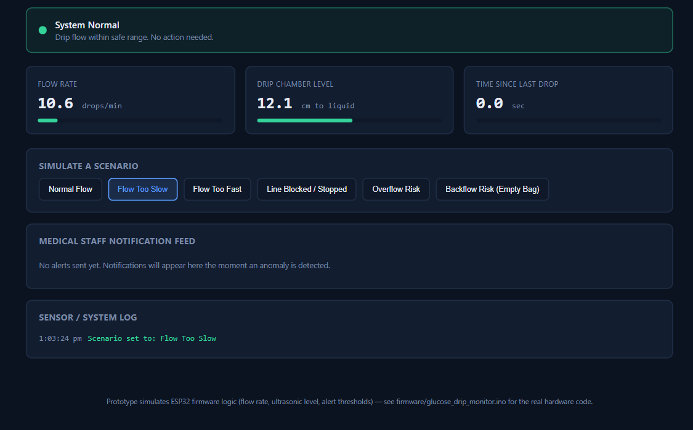
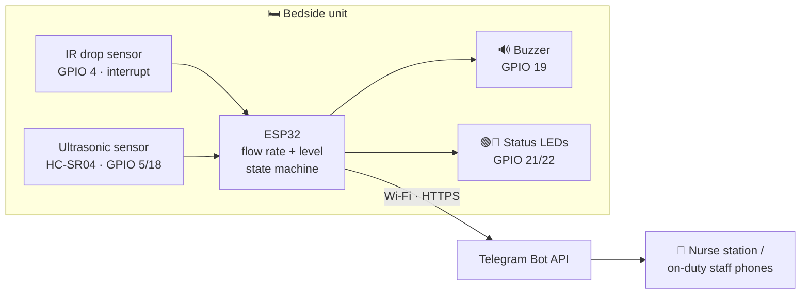
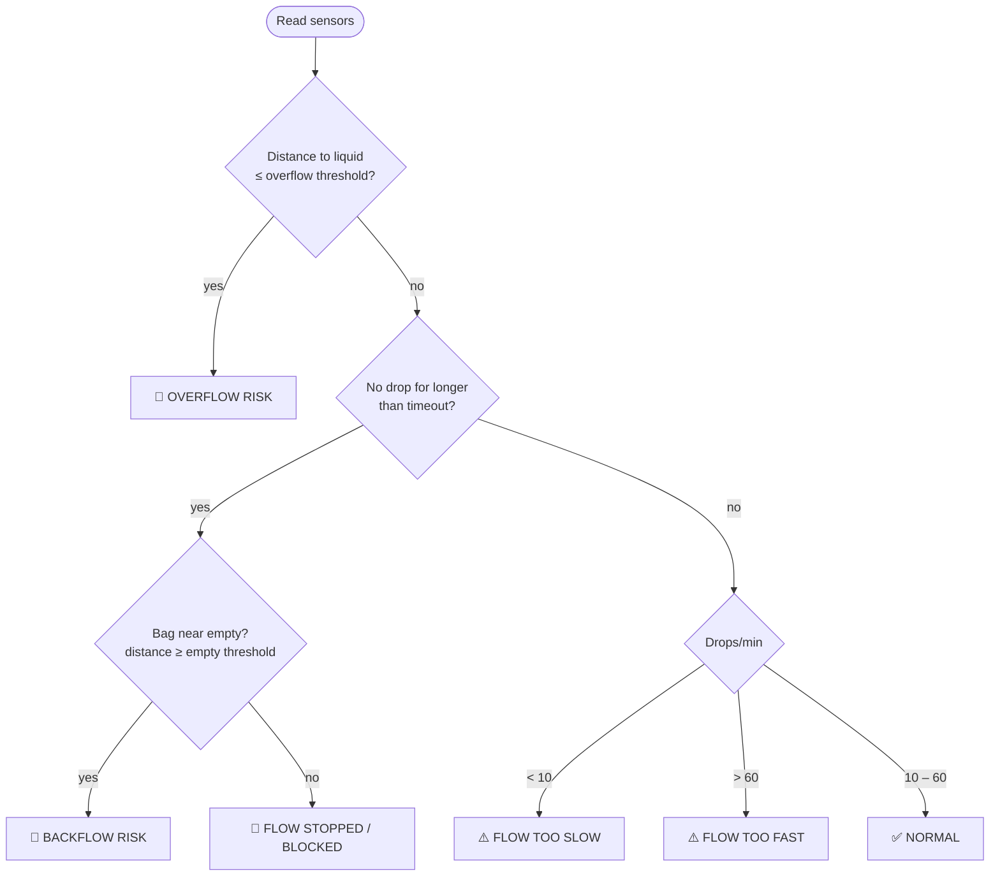
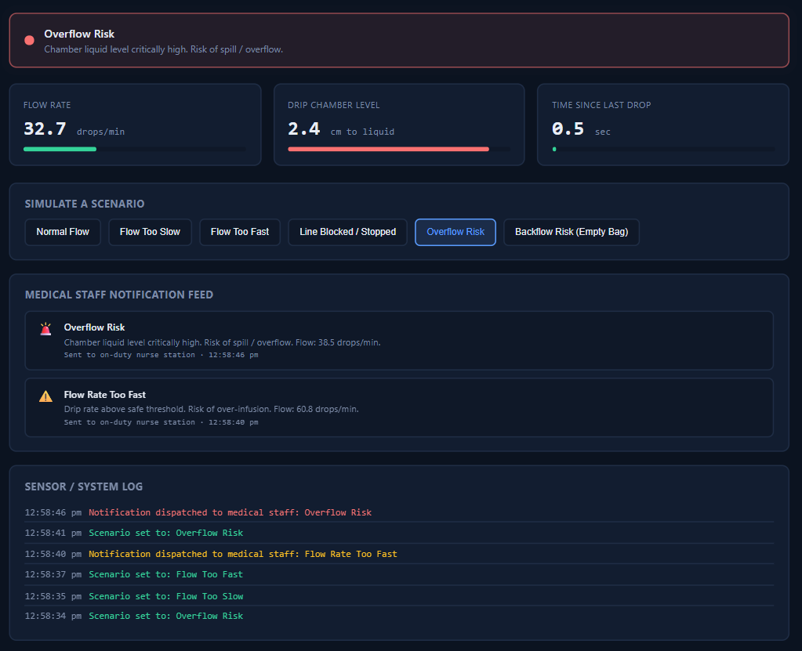
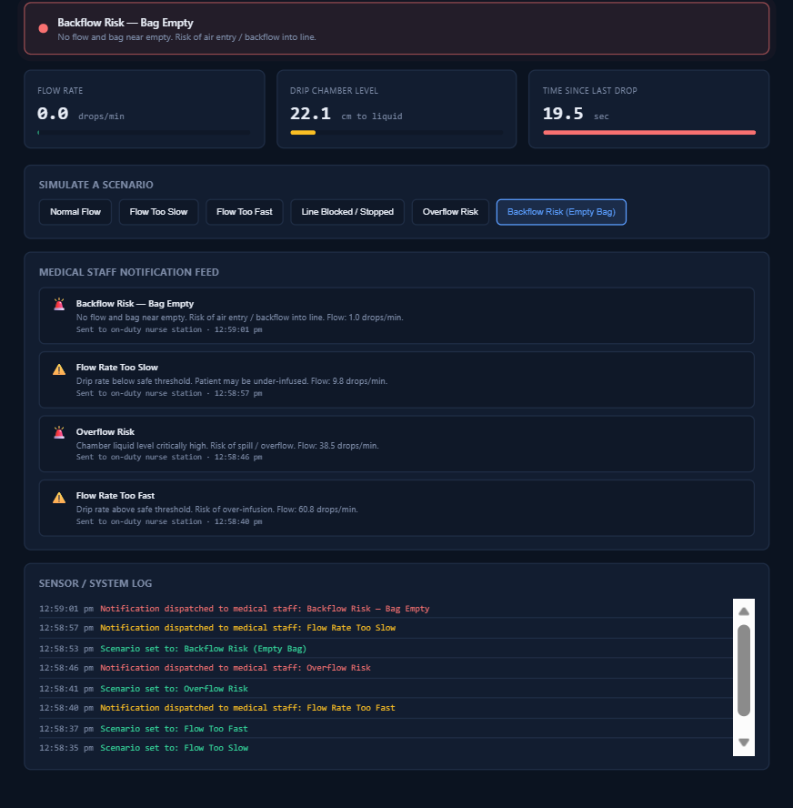

<div align="center">

# 💧 IoT Glucose Drip Monitoring System

### An ESP32-based monitor that watches an IV glucose drip in real time, detects unsafe flow, overflow and backflow conditions, and alerts nursing staff instantly with a local alarm and a Telegram push notification


**[▶️ Open the live demo](https://bibishav26.github.io/iot-glucose-drip-monitor/prototype/)** · [Firmware](firmware/glucose_drip_monitor.ino) · [Prototype source](prototype/index.html)



</div>

---

## 📌 Table of Contents
- [The Problem](#-the-problem)
- [What It Does](#-what-it-does)
- [System Architecture](#-system-architecture)
- [Alert Logic](#-alert-logic)
- [Live Prototype](#-live-prototype)
- [Hardware](#-hardware)
- [Firmware](#-firmware)
- [Getting Started](#-getting-started)
- [Repository Structure](#-repository-structure)
- [Design Decisions](#-design-decisions)
- [Roadmap](#-roadmap)
- [Disclaimer](#%EF%B8%8F-disclaimer)

---

## 🩺 The Problem

In many hospital wards, glucose and IV drips are still checked **by eye**. Nurses walk past each bed to see whether the drip is running, how fast it's dripping and whether the bag is nearly empty. Problems can go unnoticed between checks:

- **Flow too slow or stopped:** a kinked or blocked line means the patient is under-infused.
- **Flow too fast:** a risk of over-infusion.
- **Bag runs empty:** a risk of air entering the line and backflow.
- **Drip chamber overfills:** a risk of spill or overflow.

This project **automates that supervision**. A low-cost sensor unit sits on the drip set, checks it continuously, and notifies staff the moment something goes wrong, so nurses can spend their time on patients rather than routine checks.

---

## ✨ What It Does

- 💧 **Counts drops in real time** with an IR drop sensor on a hardware interrupt, and converts the count to **drops per minute**.
- 📏 **Measures liquid level** in the drip chamber or bag with an ultrasonic sensor.
- 🧠 **Classifies the drip into 6 states**: Normal, Too Slow, Too Fast, Stopped/Blocked, Overflow Risk and Backflow Risk.
- 🚨 **Raises a local alarm instantly**: buzzer plus a red LED, with a green LED when everything is normal.
- 📲 **Sends a push notification to medical staff** through the Telegram Bot API, with the status, flow rate and a call to action.
- 🔕 **Avoids alert fatigue**: it notifies immediately when the state changes, then at most once a minute while a condition continues.
- 📶 **Keeps working offline**: if Wi-Fi is down, the local buzzer and LED alarms still work.
- 🖥️ **Includes a browser prototype** that runs the same alert logic with simulated sensors, so anyone can try it without hardware.

---

## 🏗️ System Architecture



**Data flow:**
1. Each falling drop breaks the IR beam, and an **interrupt service routine** increments a counter and timestamps the drop.
2. Every **5 seconds** the ESP32 converts the drop count to **drops/min**.
3. Every loop (about 200 ms), it reads the **ultrasonic distance to the liquid surface**.
4. A **priority-ordered state machine** evaluates flow, time since the last drop, and level.
5. The **local alarm** follows the current state, and **staff notifications** are rate-limited.

---

## 🧠 Alert Logic

The state is evaluated **in priority order**: the most immediate physical risk wins.



| State | Trigger | Severity | Local alarm | Staff notified |
|---|---|:---:|:---:|:---:|
| ✅ Normal | 10–60 drops/min, level in range | — | Green LED | — |
| ⚠️ Flow too slow | < 10 drops/min | Warning | Buzzer + red LED | ✅ |
| ⚠️ Flow too fast | > 60 drops/min | Warning | Buzzer + red LED | ✅ |
| 🚨 Flow stopped / blocked | No drop within the timeout | Critical | Buzzer + red LED | ✅ |
| 🚨 Overflow risk | Liquid surface very close to the sensor | Critical | Buzzer + red LED | ✅ |
| 🚨 Backflow risk | No flow **and** bag near empty | Critical | Buzzer + red LED | ✅ |

### Thresholds

The ultrasonic sensor measures the **distance to the liquid surface**. A **smaller distance means a higher level** (overflow), and a **larger distance means a lower level** (empty bag).

| Constant | Firmware | Browser demo | Meaning |
|---|---:|---:|---|
| `NORMAL_MIN_DROPS_PER_MIN` | 10 | 10 | Below this, flow is too slow |
| `NORMAL_MAX_DROPS_PER_MIN` | 60 | 60 | Above this, flow is too fast |
| `NO_DROP_TIMEOUT_MS` | 15 s | 8 s | No drop for this long means flow has stopped |
| `OVERFLOW_LEVEL_CM` | ≤ 3 cm | ≤ 4 cm | Overflow risk |
| `EMPTY_BAG_LEVEL_CM` | ≥ 20 cm | ≥ 20 cm | Bag near empty |
| `NOTIFY_COOLDOWN_MS` | 60 s | 20 s | Minimum gap between repeat alerts for an ongoing condition |

The demo uses shorter timings so scenarios play out quickly on screen. All values are constants at the top of each file, so they can be tuned for a specific IV set and drop factor.

**Example staff notification (Telegram):**
```
GLUCOSE DRIP ALERT
Status: Backflow risk - bag empty, no flow
Flow rate: 0.0 drops/min
Action required: Please check patient line immediately.
```

---

## 🖥️ Live Prototype

`prototype/index.html` is a **single-file, dependency-free dashboard** that simulates the IR and ultrasonic sensors and runs **the same state machine as the firmware**. Open it in any browser, or use the [live demo](https://bibishav26.github.io/iot-glucose-drip-monitor/prototype/).

**Features:**
- Live readings for **flow rate**, **drip-chamber level** and **time since the last drop**, with colour-coded bars
- A **status banner** that turns amber for warnings and pulses red for critical states, plus an **audible alarm** (Web Audio API)
- A **Medical Staff Notification Feed** that shows each alert as it would be sent to the nurse station
- A timestamped **sensor and system log**
- **Scenario buttons** to simulate Normal, Too Slow, Too Fast, Blocked, Overflow and Backflow

| Overflow risk detected | Backflow risk with full alert history |
|:---:|:---:|
|  |  |

Readings ease towards each scenario's target with a little random noise, so transitions look like real sensor data rather than jumping instantly.

---

## 🔌 Hardware

### Components

| Component | Purpose | Notes |
|---|---|---|
| **ESP32 dev board** | Microcontroller with built-in Wi-Fi | Any ESP32 DevKit |
| **IR drop sensor** (IR LED + phototransistor / slotted IR module) | Detects each falling drop | Mounted around the drip chamber |
| **HC-SR04 ultrasonic sensor** | Measures distance to the liquid surface | Mounted above the chamber or bag |
| **Active/passive buzzer** | Audible local alarm | |
| **Green + red LEDs** (with ~220 Ω resistors) | Normal / alarm indicators | |
| Breadboard, jumper wires, USB power | | |

### Wiring

| Signal | ESP32 GPIO |
|---|:---:|
| IR drop sensor OUT (interrupt, falling edge) | **4** |
| Ultrasonic TRIG | **5** |
| Ultrasonic ECHO | **18** |
| Buzzer | **19** |
| Green "OK" LED | **21** |
| Red "Alarm" LED | **22** |

> ⚡ The HC-SR04 ECHO pin outputs 5 V, but ESP32 GPIOs are 3.3 V. Use a voltage divider (e.g. 1 kΩ / 2 kΩ) or a 3.3 V-compatible ultrasonic module.

---

## 💻 Firmware

`firmware/glucose_drip_monitor.ino` (Arduino C++ for ESP32):

| Part | How it works |
|---|---|
| **Drop counting** | `attachInterrupt(..., FALLING)` runs an ISR (`IRAM_ATTR`) that increments `dropCount` and stores `lastDropTimeMs`, so no drop is missed whatever the main loop is doing |
| **Flow rate** | Every 5 s: `dropsPerMinute = dropCount / minutesElapsed`, then the window resets |
| **Level sensing** | 10 µs trigger pulse, then `pulseIn()` with a 30 ms timeout, then `distance = duration × 0.0343 / 2` |
| **State machine** | `evaluateState()` applies the priority order Overflow, then Stopped/Backflow, then Slow/Fast, then Normal |
| **Local alarm** | `handleLocalAlarm()` switches the LEDs and buzzer (`tone(2000 Hz)`) |
| **Notifications** | `maybeNotifyStaff()` sends on a state change or after the 60 s cooldown, through `sendTelegramAlert()` (HTTPS GET with a URL-encoded message) |
| **Resilience** | If Wi-Fi fails to connect, it logs the failure and continues with local alarms only |

`sendTelegramAlert()` is the only function tied to Telegram. To use an **SMS gateway, email, MQTT broker or hospital app backend** instead, replace its body; nothing else needs to change.

---

## 🚀 Getting Started

### Try the prototype (no hardware)
```bash
git clone https://github.com/Bibishav26/iot-glucose-drip-monitor.git
cd iot-glucose-drip-monitor
# open prototype/index.html in your browser
```
Click any scenario button. Click once anywhere on the page first so the browser allows the alarm sound.

### Run on real hardware
1. Install the **ESP32 board package** in Arduino IDE (Boards Manager → *esp32 by Espressif Systems*).
2. Wire the sensors as shown in the [wiring table](#wiring).
3. Create a Telegram bot with **@BotFather** and copy the bot token. Get your chat ID from **@myidbot** (or a group chat ID for a whole nurse station).
4. Open `firmware/glucose_drip_monitor.ino` and fill in:
   ```cpp
   const char* WIFI_SSID          = "YOUR_WIFI_SSID";
   const char* WIFI_PASSWORD      = "YOUR_WIFI_PASSWORD";
   const char* TELEGRAM_BOT_TOKEN = "YOUR_BOT_TOKEN";
   const char* TELEGRAM_CHAT_ID   = "YOUR_CHAT_ID";
   ```
5. Select your ESP32 board and port, then **Upload**.
6. Open **Serial Monitor at 115200 baud**. You should see the Wi-Fi connection and state-change logs.
7. Calibrate `OVERFLOW_LEVEL_CM` and `EMPTY_BAG_LEVEL_CM` for your sensor's mounting height.

> 🔐 Never commit real Wi-Fi passwords or bot tokens. Keep the placeholders in the repo and fill them in locally only.

---

## 📁 Repository Structure

```
iot-glucose-drip-monitor/
├── firmware/
│   └── glucose_drip_monitor.ino   # ESP32 firmware: sensors, state machine, alarms, Telegram alerts
├── prototype/
│   └── index.html                 # Browser dashboard: simulated sensors + same alert logic
├── assets/                        # Dashboard screenshots used in this README
├── LICENSE
└── README.md
```

---

## 🧩 Design Decisions

- **Interrupt-driven drop counting:** drops are short events, and polling in `loop()` could miss them. An ISR captures every one.
- **Priority-ordered states:** overflow is checked first because it's the most immediate physical risk. Backflow is only declared when flow has stopped *and* the bag is empty, which separates an empty bag from a blocked line.
- **Alert cooldown:** re-alerting every loop would spam staff and cause alert fatigue. The unit notifies on every state change, then at most once per minute while a condition continues.
- **Local alarm first, network second:** the buzzer and LEDs never depend on Wi-Fi, so a network outage can't silence a bedside alarm.
- **A swappable notification layer:** keeping all Telegram code in one function makes it easy to move to a hospital's own system.
- **Firmware and prototype logic kept the same:** the browser demo uses the same thresholds and decision order, so it's an accurate way to demo and test the logic without hardware.

---

## 🗺️ Roadmap

- [ ] Read the drip rate in **mL/hour** using the IV set's drop factor (e.g. 20 drops/mL)
- [ ] **Multi-bed dashboard**: ESP32 units publish over **MQTT**, with a central web dashboard for the nurse station
- [ ] Log readings to a database (e.g. InfluxDB or Firebase) for infusion history and reports
- [ ] Debounce and filter the IR sensor to reject false triggers from vibration or light
- [ ] Add a weight sensor (load cell) for more accurate remaining-volume estimates
- [ ] Battery operation with deep-sleep between readings
- [ ] Atomic read-and-reset of the shared drop counter (critical section) for robustness
- [ ] Add a nurse "acknowledge" button to silence the local alarm once attended

---

## ⚠️ Disclaimer

This is an **educational prototype**. It is **not a certified medical device** and must not be used for real patient care without proper clinical validation, safety engineering and regulatory approval.

---

## 📄 License

Released under the [MIT License](LICENSE).

<div align="center">

⭐ If you find this project useful, consider giving it a star!

</div>
